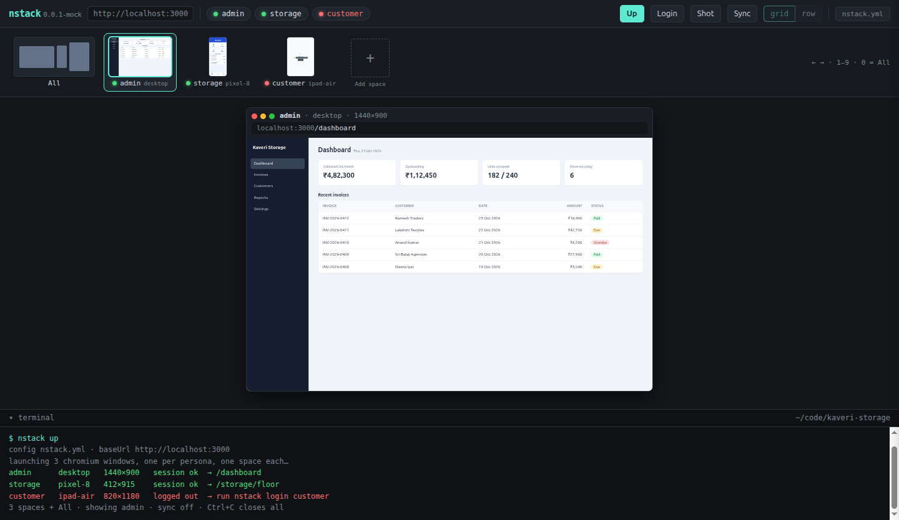

# nstack

Open your web app as several users at several screen sizes, side by side, already logged in.

Every role-based app has to be checked as different users on different screens: the admin on a desktop, the floor worker on a phone, the customer on a tablet. Today that means incognito windows, logging in by hand and toggling DevTools device mode, every day. `nstack up` opens one window with a space per persona, each at its own device size, each with its own saved login. Open source, local only, no cloud, no telemetry.



<sub>The approved design (`nstack mock`); the real shell matches it.</sub>

## Quick start

Needs Node 22.12+ and a dev server you can log in to.

```sh
npm i -g @akbarsha03/nstack      # the command is `nstack`; pulls Electron (~200 MB) the first time
cd ~/code/your-app
nstack init                      # writes nstack.yml, adds .nstack/ to .gitignore
# edit nstack.yml: baseUrl, your roles, their devices and start pages
nstack login --all               # log in once per persona; the session is kept
nstack up                        # every persona, side by side
```

Before the first npm release, install from source: `git clone https://github.com/akbarsha03/nstack.git && cd nstack && npm i && npm i -g .`

## Config

`nstack.yml` in your project root (or `-c <file>` on any command):

```yaml
baseUrl: http://localhost:3000   # required, http(s)
loginPath: /sign-in              # default /sign-in; landing here means "logged out"
tile: grid                       # All space: grid (default) | row
personas:                        # at least one; names: lowercase letters, digits, dashes, max 16
  admin:
    device: desktop              # default desktop
    start: /dashboard            # default /
  storage:
    device: pixel-8
    start: /storage/floor
  customer:
    device: ipad-air
    start: /portal
    login:                       # optional scripted login; leave out to log in by hand
      fill:
        "input[name=login]": "customer@example.com"
        "input[name=password]": "$CUSTOMER_PASSWORD"
      submit: "button[type=submit]"
```

| Device | Viewport | Pixel ratio | Touch, mobile user agent |
|---|---|---|---|
| `iphone-15` | 393×852 | 3 | yes (iOS) |
| `pixel-8` | 412×915 | 2.625 | yes (Android) |
| `ipad-air` | 820×1180 | 2 | yes (iPadOS) |
| `laptop` | 1280×800 | 1 | no |
| `desktop` | 1440×900 | 1 | no |
| `WxH`, e.g. `1366x768` | as written | 1 | no |

- `$NAME` / `${NAME}` in any value is read from the environment. An unset variable is an error, so a secret never goes out empty. A literal password in `login.fill` works but `nstack login` warns about it.
- `login.fill` maps a CSS selector to the value typed into it; `submit` is the selector clicked afterwards.
- Sessions (cookies, storage) live in `.nstack/` next to the config. They are real logins: keep `.nstack/` out of git (`nstack init` does that).

Ready-made configs: [Rails + Devise](examples/rails-devise/nstack.yml), [Next.js + Auth.js](examples/nextjs-auth/nstack.yml), and the one we dogfood on [Nidhi Stack](examples/nidhi-stack/nstack.yml).

## Commands

| Command | Does |
|---|---|
| `nstack init` | Write a sample `nstack.yml` with two personas (never over an existing one) and add `.nstack/` to `.gitignore`. Electron itself comes with the npm install. |
| `nstack login <persona>…` | Open a window on that persona's session at `loginPath`. Log in by hand (or let the `login` block fill the form); it closes once the app sends you elsewhere. |
| `nstack login --all` | The same for every persona, one after another. |
| `nstack up [personas…]` | Open the shell with every (or the named) persona as a space. `--sync` mirrors navigation. |
| `nstack add <name> --device <preset> [--start /path]` | Append a persona to `nstack.yml` and open its space, in the shell already running in that folder or a new one. The rest of the file, comments included, stays as you wrote it. |
| `nstack shot [path]` | Screenshot every persona at `path` (default: each `start`) at its real viewport size to `.nstack/shots/<persona>.png`. Uses the running shell if there is one, otherwise shoots offscreen and exits. The shell's **Screenshot** button asks for a folder instead (remembered for next time). |
| `nstack reset [persona…]` | Forget saved sessions for every (or the named) persona. |
| `nstack mock` | Serve the clickable UI mock in your browser (also what plain `nstack` does). |

Run `login` and `reset` while `nstack up` is closed. `nstack <command> --help` lists every option.

## The shell

- **Spaces.** One persona fills the view, scaled to fit with its true aspect ratio; the strip shows a live thumbnail of each. Switch with a click, ← / →, `1`–`9`; `0` or `a` is the **All** space, every persona tiled (`grid` keeps relative sizes honest, `row` gives one shared height). The **+** tile adds a persona; drag a tile to reorder the strip (the order is remembered, and `1`–`9` follow it). Each frame's title bar has an address bar: type a path (or a full URL) and press Enter to take that persona there; with Sync on the others follow.
- **Control bar.** Persona chips (red dot = logged out, click to log in; green = click to forget the session), **Up** (every persona back to its start page), **Login** (the first logged-out persona), **Screenshot** (asks where to save, then shoots every persona), **Sync**, `grid` / `row`, and a read-only `nstack.yml` drawer. The last space, Sync and tile mode are remembered.
- **Terminal pane.** Echoes every action as the CLI line it stands for; click its header to collapse it.
- **Logged out.** A persona the app bounces to `loginPath` shows a placeholder telling you to run `nstack login <persona>`.
- **Sync** (`--sync` or the toggle). Navigate one persona to `/invoices` and the others follow, each as its own user. Only the path is replayed (no scroll or clicks); logged-out personas are skipped with a note.
  - **⚙ Sync preferences**: replay the query string and hash or the path only, let only the space you're looking at lead, and pick which spaces follow. Saved in `.nstack/state.json`.

## Notes

- **OTP, magic-link or SSO login:** leave out the `login` block and log in by hand once; the session lasts as long as your app's remember-me cookie.
- **Linux:** on Ubuntu 24+ Chromium's sandbox needs `chrome-sandbox` to be setuid root. Until it is, nstack runs without the sandbox and prints the one-line fix.
- **macOS / Windows:** built to work, tested so far on Linux only.

## Develop

```sh
git clone https://github.com/akbarsha03/nstack.git && cd nstack && npm i
npm test                                   # unit tests
NSTACK_E2E=1 node --test --test-concurrency=1 dist/test/*.e2e.test.js   # real Electron, needs a display
```

Spec and design: [docs/MVP.md](docs/MVP.md), [mock/index.html](mock/index.html).

## License

MIT
